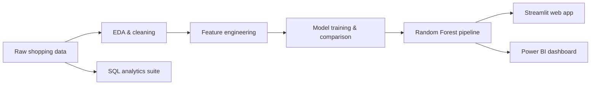
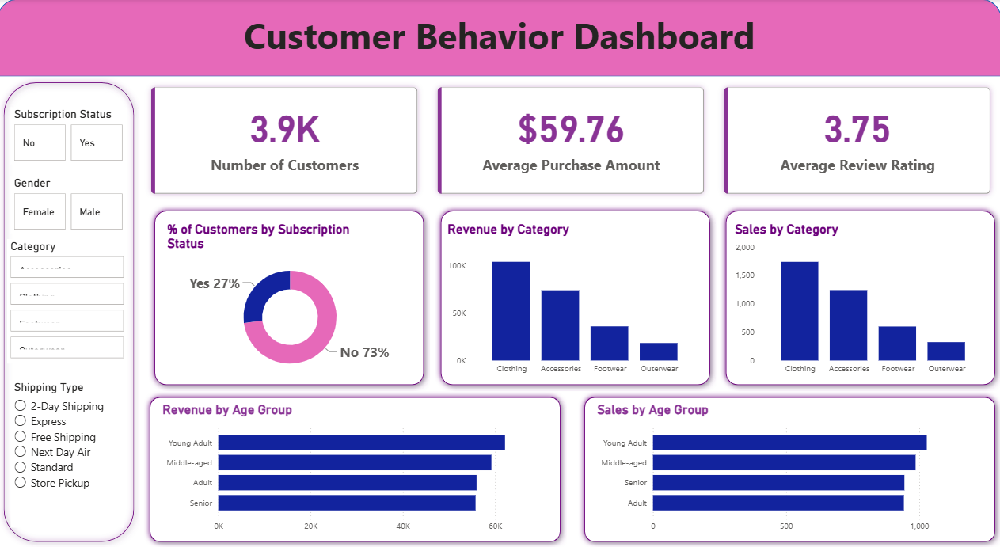

# 🛍️ Retail Subscription Propensity — ML Prediction Engine

> End-to-end machine learning system predicting which retail customers are most likely to convert to a premium subscription — served as an interactive Streamlit app, with a Power BI executive dashboard and a SQL analytics suite.

[](https://www.python.org/)
[](https://streamlit.io/)
[](https://scikit-learn.org/)
[](LICENSE)

**🌐 Live demo:** https://retail-subscription-propensity.streamlit.app

---

## The Problem

Retailers bleed margin on blanket discounts. This project scores every customer on **subscription propensity** so marketing teams can target incentives at high-propensity shoppers instead of discounting everyone.

## The Solution

A complete ML pipeline — from raw shopping-behavior data to a deployed prediction app:



## Model Performance

| Model | Accuracy | Precision | Recall | F1-Score | ROC-AUC |
|---|---|---|---|---|---|
| Logistic Regression | 0.865 | 0.668 | 1.000 | 0.801 | 0.909 |
| **Random Forest ✅** | 0.853 | 0.671 | 0.891 | 0.766 | **0.912** |

**Random Forest selected.** Note the Logistic Regression trap: its perfect recall (1.000) comes from over-predicting the positive class — accuracy alone is misleading on imbalanced targets, so the model is judged on ROC-AUC and the precision/recall balance instead.

## App Features

- 🎯 **Probability scorecard** — subscription conversion probability with high/low propensity badges
- 👤 **Guardrailed inputs** — 22 known products and all 50 US states as dropdowns (no free-text, so no unseen-category leakage at inference time)
- ⚡ **Scenario presets** — one-click customer profiles for instant evaluation
- 📊 **Power BI dashboard** — executive view of customer behavior (`dashboard/`)
- 🗄️ **SQL analytics suite** — 8+ business queries: revenue by segment, discount analysis, loyalty tiers (`sql/`)

## Tech Stack

Python · scikit-learn · pandas · Streamlit · Power BI · SQL (MySQL via SQLAlchemy) · joblib

## Project Structure

```
├── app.py                  # Streamlit prediction app
├── db.py                   # Database persistence layer
├── models/                 # Serialized sklearn pipeline (.pkl)
├── notebooks/              # EDA + feature engineering notebooks
├── dashboard/              # Power BI dashboard (.pbix + preview)
├── sql/                    # Business analytics queries
├── data/                   # Raw + cleaned datasets
└── requirements.txt
```

## Quickstart

```bash
git clone https://github.com/raomiran14/retail-subscription-propensity.git
cd retail-subscription-propensity
pip install -r requirements.txt
streamlit run app.py
```

## Dashboard Preview



## What's Next

- [ ] Probability calibration for the scorecard
- [ ] XGBoost / LightGBM comparison
- [ ] Threshold tuning via precision-recall analysis

## License

MIT — see [LICENSE](LICENSE).
